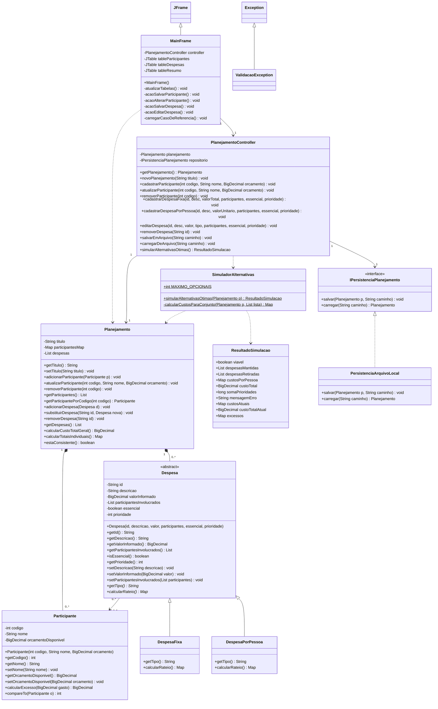

# Modelagem

## Diagrama de classes

Legenda: `-` privado, `+` público, `*` abstrato, `$` estático.

O Mermaid não aceita vírgula em tipo genérico, então no diagrama aparece só `Map` e `List`. No código, `participantesMap` é um `Map<Integer, Participante>` criado como `TreeMap`, `despesas` é uma `List<Despesa>`, e os rateios e totais são `Map<Participante, BigDecimal>`. `ResultadoSimulacao` é uma classe declarada dentro de `SimuladorAlternativas`.

A `MainFrame` está resumida, só com os métodos principais. As classes gravadas em arquivo (`Planejamento`, `Participante` e as despesas) implementam `Serializable`, e `Participante` também implementa `Comparable`, para ordenar pelo código.

## Relações

O `Planejamento` contém os participantes e as despesas (composição). Eles só existem dentro de um planejamento e somem junto com ele quando o usuário cria um novo. A multiplicidade é 0..* porque o programa abre com o planejamento vazio.

Cada `Despesa` aponta para os participantes que dividem a conta, pelo menos um. É associação comum, porque a despesa não cria participante, só referencia quem já está cadastrado. O `Planejamento` confere isso na hora de adicionar a despesa.

`DespesaFixa` e `DespesaPorPessoa` herdam de `Despesa`. Os dados são os mesmos, o que muda é a conta do rateio.

`PersistenciaArquivoLocal` implementa `IPersistenciaPlanejamento`. O controlador guarda o repositório pelo tipo da interface.

O `SimuladorAlternativas` só lê o planejamento e devolve um `ResultadoSimulacao`, por isso a ligação é de dependência. O controlador chama o simulador, e a tela lê os dados do planejamento para montar as tabelas.

## Coleções

- `TreeMap<Integer, Participante>` para os participantes: a busca é pelo código, a chave não deixa repetir código e o mapa já fica em ordem, que é a ordem mostrada na tela.
- `ArrayList<Despesa>` para as despesas: mantém a ordem de cadastro, que é a ordem em que elas aparecem na tela. Na edição, a despesa é trocada na mesma posição.
- `List<Participante>` dentro da despesa: o construtor tira os repetidos antes de guardar.
- `Map<Participante, BigDecimal>` para rateios e totais. É um `HashMap`, porque ali só buscamos o valor de cada pessoa. No simulador usamos `TreeMap`, para a lista de custos sair em ordem de código. Na despesa fixa, os centavos que sobram são distribuídos depois de ordenar os participantes da despesa pelo código.

## Conceitos de POO no código

Os atributos do modelo são privados, e os setters validam o valor antes de guardar. Para alterar um participante, o `Planejamento` valida o nome e o orçamento juntos antes de chamar os setters, assim um erro no orçamento não deixa o nome já trocado. Para editar uma despesa, criamos outra e trocamos na lista, e com isso tudo passa pela validação do construtor. As listas saem das classes como cópia ou como lista não modificável.

`Despesa` é abstrata, com `getTipo()` e `calcularRateio()` abstratos, e as duas subclasses implementam os dois. O polimorfismo aparece em `Planejamento.calcularTotaisIndividuais` e `calcularCustoTotalGeral`, que percorrem a lista de despesas chamando `calcularRateio()` sem saber qual é o tipo.

A interface de persistência é usada em `salvarEmArquivo` e `carregarDeArquivo`, no controlador.

Quando uma regra é violada, o modelo lança `ValidacaoException` com a mensagem que vai aparecer na tela.

## Caminho de uma ação (MVC)

Exemplo com o botão "Salvar Alteração" da aba de despesas:

1. A tela (`MainFrame.acaoEditarDespesa`) lê os campos do formulário, converte o valor e a prioridade para número e chama `controller.editarDespesa`.
2. O controlador cria uma `DespesaFixa` ou uma `DespesaPorPessoa`, conforme o tipo escolhido.
3. O construtor de `Despesa` valida os dados. Se passar, `Planejamento.substituirDespesa` troca a despesa antiga pela nova.
4. A tela chama `atualizarTabelas`, que busca os totais no modelo e redesenha tudo.

Se o texto digitado não for um número, a própria tela avisa. Se alguma regra do modelo falhar, a `ValidacaoException` sobe até a tela, que mostra a mensagem num `JOptionPane`. Nos dois casos nada é alterado, porque a troca da despesa é o último passo.
